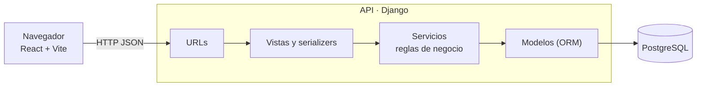
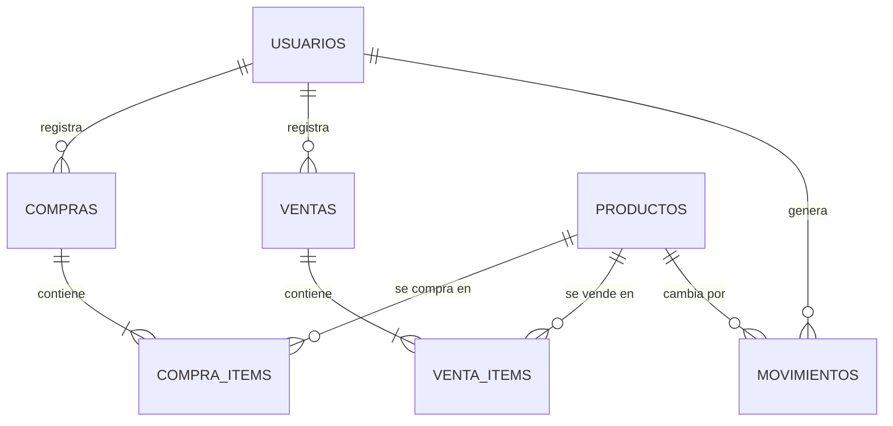

# Cuadra

**Inventario que cuadra.** Aplicación web para que un pequeño negocio lleve productos, compras, ventas y existencias en un solo lugar, con historial confiable y margen por venta calculado automáticamente.


> **Estado:** en construcción. Ver la [hoja de ruta](#hoja-de-ruta).

**Demo:** _(pendiente, se agrega al terminar la fase 0)_

## El problema

Muchos negocios pequeños llevan el inventario con planillas desconectadas y relacionan a mano el costo de compra con el precio de venta. Casos reales que motivaron el proyecto:

- [Negocio de subastas que registra todo en planillas separadas](https://www.reddit.com/r/smallbusiness/comments/1mecoxb/small_business_needs_inventoryinvoicing/)
- [Fabricante 3D al que las planillas ya no le sirven con más de 50 componentes](https://www.reddit.com/r/smallbusiness/comments/1qhn7ea/inventory_management_software_for_very_small/)

Cuadra no pretende ser un ERP. Resuelve una parte acotada del problema con un alcance controlado.

## ¿Por qué "Cuadra"?

En el comercio, "cuadrar" es hacer que las cuentas calcen. Ese es el objetivo del proyecto: que el stock que ves siempre coincida con la suma de todo lo que entró y salió, y que cada compra y venta se pueda explicar hasta el último movimiento.

## Qué incluye la v1

- Productos: crear, editar, desactivar y buscar.
- Movimientos de inventario con historial inmutable.
- Compras y ventas con varias líneas.
- Costo promedio y margen por venta.
- Alertas de stock bajo e indicador de quiebres.
- Autenticación con roles (`admin` y `operador`).

Fuera de la v1: facturación tributaria, contabilidad, códigos de barras, proveedores avanzados y fabricación.

El detalle completo está en [`docs/requisitos.md`](docs/requisitos.md).

## Cómo funciona

### Principios de diseño

| Tema | Decisión |
|---|---|
| Stock | Los movimientos son la fuente de verdad ([ADR-001](docs/decisiones/ADR-001-movimientos-fuente-de-verdad.md)) |
| Integridad | Sin stock negativo, con descuento atómico en la base ([ADR-002](docs/decisiones/ADR-002-sin-stock-negativo.md)) |
| Costos | Costo promedio ponderado ([ADR-003](docs/decisiones/ADR-003-costo-promedio-ponderado.md)) |
| Acceso | Un negocio, dos roles ([ADR-004](docs/decisiones/ADR-004-un-negocio-dos-roles.md)) |
| Historial | Nada se borra ([ADR-005](docs/decisiones/ADR-005-nada-se-borra.md)) |
| Dinero | Enteros en CLP, nunca `float` ([ADR-006](docs/decisiones/ADR-006-dinero-en-enteros.md)) |
| Backend | Django con PostgreSQL ([ADR-007](docs/decisiones/ADR-007-backend-django.md)) |

### Un problema real: ventas simultáneas

Si dos ventas del mismo producto llegan al mismo tiempo, ambas podrían leer "quedan 3" y vender 3 cada una. Cuadra descuenta el stock de forma atómica dentro de una transacción:

```sql
UPDATE productos
SET stock_actual = stock_actual - $1
WHERE id = $2 AND stock_actual >= $1
RETURNING stock_actual;
```

Si no devuelve fila, no había stock suficiente y se revierte toda la venta. Un test de integración dispara ventas en paralelo y verifica que el stock nunca queda negativo.

### Arquitectura



### Modelo de datos

_Borrador, se confirma en la fase 1b junto con las migraciones._



## Stack

- **Frontend:** React, Vite, React Router, TanStack Query
- **API:** Python y Django (más Django REST Framework desde el primer endpoint)
- **Base de datos:** PostgreSQL
- **Pruebas:** pytest con pytest-django, contra PostgreSQL real; `ruff` para el lint
- **CI:** GitHub Actions
- **Contenedores:** Docker y Docker Compose

## Estructura del repositorio

```
cuadra/
├── api/                  # API (Django)
│   ├── manage.py
│   ├── config/           # Configuración del proyecto (settings, urls, /health)
│   ├── requirements.txt  # Dependencias de la API (y requirements-dev.txt)
│   ├── pyproject.toml    # Configuración de pytest y ruff
│   ├── <app>/            # Una app por dominio, se agrega con cada historia:
│   │                     # models, migrations, serializers, views y services
│   └── tests/
│       ├── unit/
│       └── integration/  # Contra PostgreSQL real
├── web/                  # Frontend (React + Vite)
│   └── src/
│       ├── api/          # Cliente de la API
│       ├── components/
│       ├── hooks/
│       └── pages/
├── docs/
│   ├── requisitos.md     # Requisitos, reglas e historias de usuario
│   └── decisiones/       # ADR (registros de decisiones)
├── scripts/              # Utilidades (datos de ejemplo, etc.)
├── .github/workflows/    # Integración continua
├── docker-compose.yml
└── .env.example
```

## Cómo correrlo localmente

Requisitos: Python 3.12 o superior, Node.js 20 o superior (para el frontend), Docker y Docker Compose.

```bash
# 1. Variables de entorno
cp .env.example .env

# 2. Base de datos
docker compose up -d db

# 3. API
cd api
python -m venv .venv
source .venv/bin/activate        # en Windows PowerShell: .venv\Scripts\Activate.ps1
pip install -r requirements-dev.txt
python manage.py runserver

# 4. Frontend (disponible tras la fase 0)
cd web && npm install && npm run dev
```

La guía paso a paso está en [`docs/inicio-local.md`](docs/inicio-local.md). _El paso 4 se completa al terminar el esqueleto de la fase 0._

### Variables de entorno

Todas están documentadas en [`.env.example`](.env.example). Nunca se sube `.env` al repositorio.

## Pruebas

```bash
cd api
ruff check .
pytest
```

Los tests de integración usan una base PostgreSQL real, porque las reglas importantes viven en las transacciones.

## Hoja de ruta

Se avanza por rebanadas verticales: cada funcionalidad se completa (migración, API, tests e interfaz) antes de pasar a la siguiente, y todo llega a producción desde el inicio.

- [x] **Requisitos y decisiones:** documento de requisitos y ADR-001 a 006
- [ ] **Fase 0 · Esqueleto andante:** repositorio, `docker-compose`, CI, `/health` y despliegue con URL pública
- [ ] **Fase 1 · Modelo de datos:** diagrama ER y migraciones
- [ ] **Fase 2 · Acceso:** autenticación, roles y primer producto de punta a punta (HU-01, 02, 03)
- [ ] **Fase 3 · Productos y ajustes:** HU-04 a 07
- [ ] **Fase 4 · Compras y ventas:** HU-09, 11 y el test de concurrencia HU-12
- [ ] **Fase 5 · Consultas:** historial, margen, panel de stock y quiebres (HU-08, 13 a 16)
- [ ] **Fase 6 · Anulaciones:** HU-10 y 14
- [ ] **Fase 7 · Pulido:** errores uniformes, documentación OpenAPI y demo

## Documentación

- [Requisitos, reglas de negocio e historias de usuario](docs/requisitos.md)
- [Inicio del proyecto en local](docs/inicio-local.md)
- [Guía de ramas y versionado](docs/ramas-y-versionado.md)
- [Registros de decisiones (ADR)](docs/decisiones/)

## Contribuir

Ver [`CONTRIBUTING.md`](CONTRIBUTING.md).

## Licencia

MIT. Ver [`LICENSE`](LICENSE).
